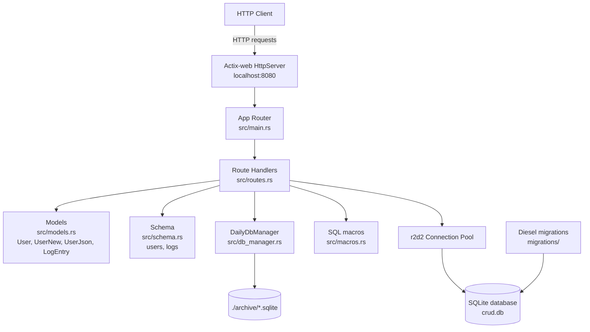

# Rust API

A small Actix-web REST API backed by SQLite through Diesel. It manages users and performs a daily database maintenance/backup workflow (logs table + attached historical database).

## Architecture



### Module responsibilities

| Module | Responsibility |
| --- | --- |
| `src/main.rs` | Application entry point, connection pool setup, route registration |
| `src/routes.rs` | HTTP handlers and request/response mapping |
| `src/models.rs` | Diesel models and JSON request/response structs |
| `src/schema.rs` | Diesel table definitions |
| `src/db_manager.rs` | SQLite backup, attach, and detach helpers for daily DB files |
| `src/macros.rs` | Reusable SQL macros (`union_active_and_attached!`) |

## Available routes

Base URL: `http://localhost:8080`

| Method | Path | Handler | Description |
| --- | --- | --- | --- |
| `GET` | `/` | `routes::root` | Health/info endpoint. Returns `REST API in Rust!` |
| `POST` | `/users` | `routes::create_user` | Creates a user. If a user with the same name already exists, returns that user instead. Request body: `{ "name": "...", "address": "..." }` |
| `GET` | `/get_users` | `routes::get_users` | Returns all users as JSON |
| `POST` | `/tasks` | `routes::create_task` | Creates a task for a user. Request body: `{ "user_id": 1, "title": "...", "description": "...", "status": "to do" }`. `status` is optional and defaults to `to do`; allowed values: `to do`, `in progress`, `done`, `blocked` |
| `GET` | `/get_tasks` | `routes::get_tasks` | Returns all tasks as JSON, including the owning user's name |
| `GET` | `/update_db` | `routes::update_db` | Maintenance endpoint. Creates the `logs` table, inserts a log row, then attaches yesterday's archived DB (if present) and unions log rows |

### Example requests

Get all users:

```shell
curl "http://localhost:8080/get_users"
```

Create a user:

```shell
curl "http://localhost:8080/users" \
  -X POST \
  -H "content-type: application/json" \
  -d '{"name":"Fey","address":"145 Av Stovia"}'
```

Create a task:

```shell
curl "http://localhost:8080/tasks" \
  -X POST \
  -H "content-type: application/json" \
  -d '{"user_id":1,"title":"Fix bug","description":"Fix login bug","status":"in progress"}'
```

List tasks:

```shell
curl "http://localhost:8080/get_tasks"
```

Run database maintenance:

```shell
curl "http://localhost:8080/update_db"
```

## Database schema

### `users`

| Column | Type | Notes |
| --- | --- | --- |
| `id` | `INTEGER` | Primary key, autoincrement |
| `name` | `TEXT` | Not null |
| `address` | `TEXT` | Not null |
| `date_created` | `TEXT` | Not null |

### `logs`

| Column | Type | Notes |
| --- | --- | --- |
| `id` | `INTEGER` | Primary key, autoincrement, nullable in model |
| `message` | `TEXT` | Not null |
| `timestamp` | `TEXT` | Not null |

### `tasks`

| Column | Type | Notes |
| --- | --- | --- |
| `id` | `INTEGER` | Primary key, autoincrement |
| `user_id` | `INTEGER` | Foreign key to `users.id`, not null |
| `title` | `TEXT` | Not null |
| `description` | `TEXT` | Not null |
| `status` | `TEXT` | One of `to do`, `in progress`, `done`, `blocked` |
| `created_at` | `TEXT` | ISO 8601 datetime string |
| `updated_at` | `TEXT` | ISO 8601 datetime string, updated when task is edited |

## Setup

### Prerequisites

- Rust toolchain (`rustup`, `cargo`)
- Optional: Diesel CLI for running migrations manually

```shell
cargo install diesel_cli --no-default-features --features "sqlite-bundled"
```

The project uses the bundled SQLite feature through `libsqlite3-sys`, so a separate system SQLite installation is usually not required.

### 1. Clone the repository

```shell
git clone <repository-url>
cd rust-api
```

### 2. Configure environment

Create a `.env` file in the project root:

```env
DATABASE_URL=crud.db
```

### 3. Run migrations

Apply the included Diesel migrations to create the database schema:

```shell
diesel migration run
```

This creates `crud.db` and the `users` and `logs` tables.

### 4. Build the project

```shell
cargo build
```

### 5. Run the server

```shell
cargo run
```

The API will be available at `http://localhost:8080`.

### 6. Verify

```shell
curl "http://localhost:8080/"
```

Expected response:

```text
REST API in Rust!
```

## Development notes

- Archived daily databases are stored in `./archive/` as `db_YYYY-MM-DD.sqlite`.
- `DailyDbManager::attach_historical_db` attaches yesterday's archive during `/update_db` if it exists.
- The `/update_db` route uses `GET` even though it performs writes; consider changing it to `POST` for stricter REST semantics.